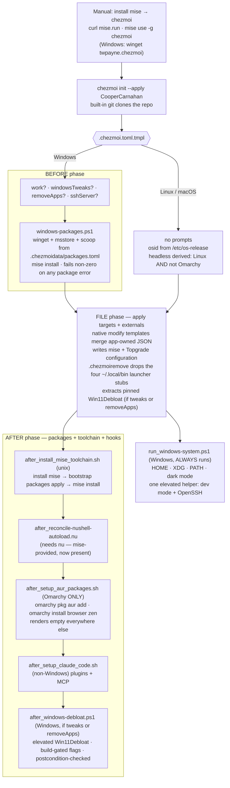

# dotfiles

Cross-platform [chezmoi](https://chezmoi.io) dotfiles for the machines this repo actually
provisions:

| Machine | Role |
|---|---|
| [Omarchy](https://omarchy.org) on Arch | Desktop daily driver — the only Linux desktop this repo targets |
| Headless Linux (Proxmox LXC, Raspberry Pis) | Servers, reached over SSH. Terminal and tools only |
| macOS | Terminal and tools only. No window manager, no desktop layer |
| Windows | Full desktop: PowerToys, Windows Terminal, GlazeWM/Zebar |

## Design

The repo stratifies into four layers. Two derived gates select between them, and **no gate
asks a question on Linux or macOS**:

```
Layer 0  tools            mise [tools], uniform          every machine
Layer 1  system packages  pacman / apt / brew / winget   is-arch-family, $deb, $darwin, windows
Layer 2  GUI app config   ghostty                        not headless, not windows
Layer 3  desktop env      Omarchy owns Linux             is-omarchy
                          macOS: empty (terminal+tools)
                          Windows: PowerToys/Terminal/glzr
```

**Desktop Linux means Omarchy.** That is a deliberate scoping decision, not a claim about the
world: `.chezmoitemplates/is-headless` derives headless as *"Linux that is not Omarchy"*, so
every other Linux — the LXC, the Pis, the test containers — is headless by construction and
there is nothing to prompt for. If another Linux desktop ever shows up, widen that helper then.

`.chezmoitemplates/is-omarchy` carries the **ownership table** — the source of truth for where
this repo stops and Omarchy begins (login, lock screen, screenshots, logout, AUR helper).
Anything in that table is Omarchy's; tracking it here makes chezmoi and `omarchy refresh`
overwrite each other.

Ghostty sits in Layer 2, not Layer 3: it is a cross-platform terminal, so it gates on *"does
this machine have a desktop"* rather than on the OS, with Windows excluded separately because
there is no ghostty build for it.

- **[mise](https://mise.jdx.dev) is the package authority on unix.** One manifest —
  `dot_config/mise/config.toml.tmpl` — declares both the dev CLI toolchain (`[tools]`: `nu`,
  ripgrep, node, uv, `claude`, and ~50 more) and the system packages
  (`[bootstrap.packages]`: pacman/apt/brew/brew-cask — OS/build packages and GUI apps).
- **Scripts cover only what mise can't:** AUR packages, which have no mise backend
  (`run_onchange_after_setup_aur_packages`, Omarchy-only), and the whole Windows layer
  (winget + scoop — mise has no backends for those).
- **[Topgrade](https://github.com/topgrade-rs/topgrade) owns updates.** It runs chezmoi first,
  then upgrades the system package manager, mise tools, and the other managers it detects.
  Chezmoi only provisions declared state and never calls Topgrade, so the flow cannot recurse.

App-owned JSON configs (`~/.claude/settings.json`, Windows PowerToys/Terminal) use native
`chezmoi:modify-template` merges. They preserve unknown/runtime keys and emit the original
bytes when the managed values already match, so application key ordering creates neither
diff noise nor apply churn. No external interpreter is required during the file phase.

`~/.codex/config.toml` also uses a native modify template. It owns only
`tui.keymap.chat.edit_queued_message` (`alt-shift-up`), leaving Herdr's Alt+Up
agent navigation available. All other Codex settings remain local. Matching
files are preserved byte-for-byte; when the shortcut needs changing, TOML
serialization preserves values but removes comments and may change formatting.
This requires a Codex version supporting custom keymaps and this action;
restart Codex after applying it. The target uses the default `~/.codex` location.

On unix the bootstrap runs almost entirely in the `after` phase
(`run_onchange_after_install_mise_toolchain`): `mise bootstrap packages apply` installs the
system packages, then `mise install` materializes the toolchain — neither can happen earlier,
because both read `~/.config/mise/config.toml`, which the file phase itself puts in place.
(Windows keeps its mise install in the `before` script, driven by scoop.)

### AUR packages, the Omarchy way

`run_onchange_after_setup_aur_packages` renders **empty on every machine that is not Omarchy**
and never bootstraps an AUR helper of its own — Omarchy preinstalls `yay` and wraps it:

```sh
omarchy pkg aur add maplemono-nf-unhinted   # idempotent: gates on omarchy-pkg-missing,
                                            # then re-verifies with `pacman -Q`
omarchy install browser zen                 # not a bare AUR add: also installs Omarchy's
                                            # firefox policies.json and MOZ_ENABLE_WAYLAND
```

The script asserts both of Zen's side effects afterwards, because `omarchy-install-browser`
has no `set -e` and exits 0 even when its `sudo` calls fail — and a `run_onchange` script only
re-fires when its *content* changes, so a silent failure would never be retried.

### `.chezmoiremove`

Four mise launcher stubs are removed from `~/.local/bin`: `claude`, `codex`, `gh`, `opencode`.
Each runs `mise use -g`, which rewrites `~/.config/mise/config.toml` — a chezmoi-managed file —
on every invocation. All four have a real mise install that PATH resolves ahead of the stub, so
removing them costs nothing.

`[tasks.bootstrap]` deliberately runs `chezmoi apply` **without `--force`**. That flag is
global, not removal-scoped: it would suppress the "has changed since chezmoi last wrote it"
prompt for every managed target and silently revert local edits. Bootstrap is run by a human at
a terminal, so a prompt is answerable — and it is the only thing that surfaces drift.

## First run on a new machine

The only manual prerequisite is mise; chezmoi comes through it. Chezmoi clones this repo with
its **built-in git**, so a system `git` is *not* required for the initial clone — `mise
bootstrap packages apply` installs git (and everything else) during the first apply.

### macOS / Linux

```sh
curl https://mise.run | sh
export PATH="$HOME/.local/share/mise/shims:$HOME/.local/bin:$PATH"
mise use -g chezmoi
chezmoi init --apply CooperCarnahan
```

`mise use -g` installs chezmoi and writes a minimal `~/.config/mise/config.toml`; the file
phase replaces it with this repo's full manifest.

The `PATH` export makes the newly installed chezmoi shim visible immediately. A login shell
will not have that directory yet on a fresh box because it did not exist at login. This is the
same invocation the Podman full-tier test validates.

**There are no chezmoi prompts on macOS or Linux.** `osid` comes from the machine's own
`/etc/os-release`, and headless is derived.

- **Omarchy:** the full desktop path. The pacman set plus ghostty apply via `mise bootstrap
  packages` in the `after` phase; AUR packages and Zen follow in `setup_aur_packages`. The
  three Hyprland user-override seams (`bindings.lua`, `input.lua`, `looknfeel.lua`) are managed
  directly — Omarchy ships them as user-owned stubs and its `hyprland.lua` already requires
  them.
- **Any other Linux (plain Arch, Debian/Ubuntu, containers):** derived headless. The build
  toolchain applies via `mise bootstrap packages`; no ghostty, no Hyprland configs, no AUR
  script.
- **macOS:** no Homebrew install needed — mise's `brew`/`brew-cask` backends install formulas
  and casks directly (one sudo prompt to create `/opt/homebrew` on a brew-less mac). Ghostty is
  installed via `brew-cask:ghostty` and **does** receive `.config/ghostty`. If you'll compile
  anything (cargo builds, etc.), run `xcode-select --install` first — nothing in the bootstrap
  pulls the CLT anymore.

### Windows

```powershell
winget install twpayne.chezmoi

# Only if enabling the OpenSSH server — init reads the SSH key from 1Password.
winget install AgileBits.1Password AgileBits.1Password.CLI

chezmoi init --apply CooperCarnahan
```

Git is not a prerequisite: chezmoi clones with its built-in git, and `Microsoft.Git`
installs during the first apply.

Windows is the only platform that prompts. Four prompts, all asked once at `init` and
persisted to `[data]`:

- **"Is this a work machine?"** — `true` skips the personal apps (1Password, NordVPN,
  Tailscale, Claude, Zen, GlazeWM).
- **"Apply Windows tweaks…?"** — defaults to `not work`. Disables telemetry, ads,
  suggestions, Bing/Copilot/Recall; enables End Task on taskbar right-click, known file
  extensions, hidden files; opens Explorer to This PC.
- **"Remove preinstalled apps…?"** — defaults to `not work`. Uninstalls 82 apps
  (upstream's curated selection **minus Teams (New) and To Do**).
- **"Enable the OpenSSH server…?"** — defaults to `false`. Installs the OpenSSH.Server
  capability, enables `sshd`, and writes the inter-computer public key (read from
  1Password at init) to `C:\ProgramData\ssh\administrators_authorized_keys` with the ACL
  sshd requires.

Tweaks and app removal are separate consents — one changes settings, the other uninstalls
software. Both share a single [Win11Debloat](https://github.com/Raphire/Win11Debloat)
invocation, pinned by version + sha256 in `.chezmoidata/packages.toml`.

Dark mode and Developer Mode stay local rather than delegated, so each setting has one
owner. Rationale for that split, and for avoiding `-RunDefaults`, is in the script
comments.

Package lists live in **`.chezmoidata/packages.toml`** (winget / msstore / scoop, with
`tags = ["personal"]` for non-work-only entries). Linux/macOS packages stay in
`dot_config/mise/config.toml.tmpl` — that is a real manifest mise consumes, not data.

- The before-script installs winget packages, then Scoop, then mise, then the toolchain.
- **If the apply stops with `mise not found on PATH`:** Scoop just added mise's shim but this
  shell hasn't picked it up. Open a new terminal and run `chezmoi apply` again.
- **Expect up to two UAC prompts** on a fresh box (one for system settings, one for
  Win11Debloat), and none once the machine has converged. This is not a fully unattended
  bootstrap.
- **If `sshServer` is on and OpenSSH isn't installed yet,** apply returns *before* sshd is
  ready — `Add-WindowsCapability` continues in a detached elevated window. Re-run
  `chezmoi apply` to confirm convergence.
- **`sshServer` needs `op` before `init`** — the key is read from 1Password at init, but
  `op` installs during apply. Init fails with an actionable error if it's missing. Requires
  the desktop app's CLI integration (Settings > Developer).

#### Updating an existing Windows machine

`.chezmoi.toml.tmpl` is only evaluated during `init`, so new config keys do not appear on
a plain `apply`/`update`:

```powershell
chezmoi update      # pull the new source state
chezmoi init        # re-prompt; promptBoolOnce keeps existing answers
chezmoi apply
```

Consumers read the new keys through `dig` with safe defaults, so an un-migrated machine
degrades to "features off" rather than failing — but it will not pick them up until
`init` is re-run.

## How the bootstrap runs

Every platform follows the same skeleton: the file phase uses dependency-free native
modifiers and writes the mise/Topgrade manifests, then the after phase provisions packages
and tools. Windows installs its application packages and mise in the before phase so those
applications exist before their configs are applied. Fastfetch is a plain, lexically last
after hook, so it is the actual completion summary.



Two Windows scripts deliberately differ in kind. `run_windows-system.ps1` is `run_`
(**always** runs): it launches a detached elevated helper, and under `run_onchange_`
chezmoi would record success from the parent's exit and skip the script forever after,
so its read-guards would never reconcile anything. `run_onchange_after_windows-debloat.ps1`
is `run_onchange_` and throws on every failure path — a warn-and-continue would be stored
as success and never retried.

## Testing

Podman-based bootstrap tests for Arch and Debian live in `tests/podman/`
(see [its README](tests/podman/README.md)). Both containers are non-Omarchy Linux, so they
exercise the derived-headless path:

```sh
tests/podman/run.sh                     # smoke tier: template render + apply asserts (~2 min)
tests/podman/run.sh --tier full debian  # full tier: the real fresh-system bootstrap
```

CI runs the smoke tier on every push/PR and the full tier weekly.

Template logic can also be checked against a synthetic OS context without a container, which
is the only way to cover Omarchy, macOS and Windows:

```sh
chezmoi execute-template --source . \
  '{{ includeTemplate "is-headless" (dict "chezmoi" (dict "os" "darwin" "osRelease" (dict))) }}'
```

`prek run --all-files` runs the formatters and linters, including a local hook that rejects an
indented `{{ if }}`/`{{ else }}`/`{{ end }}` whose left delimiter lacks the trim marker — the
one delimiter mistake that fails silently by emitting its leading whitespace as output.

## Keeping a machine current

`chezmoi apply` only **provisions**: it ensures declared packages and tools are present and
applies configuration. It does not upgrade already-installed software. Editing
`[bootstrap.packages]` or `[tools]` changes the manifest hash and re-runs provisioning.

Run `mise run update` to update the machine; it asks for confirmation before starting the
potentially lengthy Topgrade pass. The managed Topgrade config runs chezmoi first, then the
detected system and language package managers. Because chezmoi never calls Topgrade, this
one-way flow cannot recurse. Calling `topgrade` directly skips the wrapper confirmation. For
unattended agents or scripts:

```sh
mise run update-unattended
```

This passes `--yes --no-ask-retry`. On Omarchy, Topgrade is configured to use `yay`, so
repository and AUR packages participate in one full transaction rather than a partial upgrade.
`mise run bootstrap` remains a local converge command: packages, tools, then `chezmoi apply`
without fetching or upgrading anything.

## Layout

| Path | Purpose |
|---|---|
| `.chezmoi.toml.tmpl` | Data, Windows-only prompts, interpreters, structural diff + JSON normalization |
| `.chezmoiscripts/` | Per-OS `run_onchange_*` bootstrap scripts (system packages + mise) |
| `.chezmoitemplates/` | Desired JSON, the native semantic merge helper, and the `is-*` gates |
| `.chezmoiignore` | Layer-gated ignore rules |
| `.chezmoiremove` | The four `~/.local/bin` launcher stubs that rewrite managed mise config |
| `.chezmoiversion` | Minimum chezmoi version (uses `promptBoolOnce`, `includeTemplate`, `stat`, `lookPath`) |
| `dot_config/mise/config.toml.tmpl` | The dev toolchain manifest |
| `dot_config/topgrade.toml.tmpl` | One-way update orchestration and per-OS manager policy |
